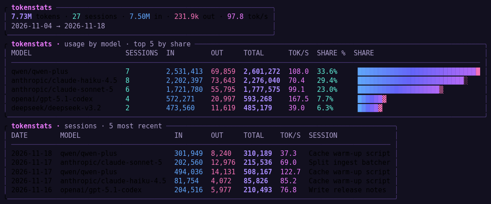
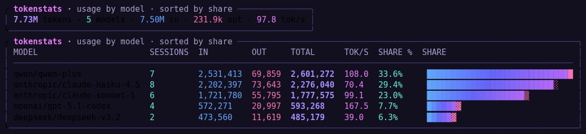
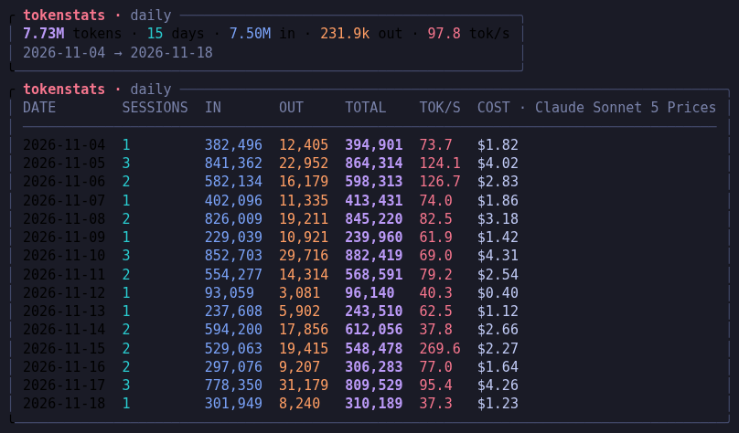
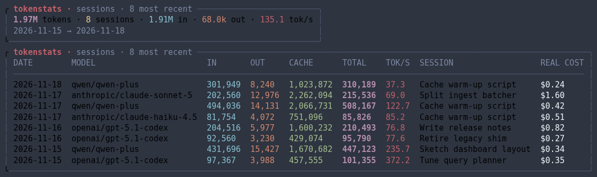

# tokenstats — permanent AI token usage record for this machine

`tokenstats` snapshots OpenCode's session database (opened read-only) into its
own SQLite store (`~/.tokenstats/usage.db`) and reports it filtered by model,
date, and token counts. OpenCode prunes its own history over time; your copy in
`usage.db` never shrinks, so this machine's full token history survives.

Single Python file, stdlib only. Runs on Linux, macOS, and Windows and finds
OpenCode's database automatically for your OS.



## Install

```bash
pipx install .         # recommended: a `tokenstats` command on PATH
# or
pip install --user .   # the same command, into your user site
```

Installing is optional — the script also runs straight from the file:

```bash
python3 tokenstats.py [options]
```

Everything below uses the installed `tokenstats` command; substitute
`python3 tokenstats.py` when running from the file.

## Use

```bash
tokenstats                                   # dashboard: totals, top models, recent sessions
tokenstats --model qwen                      # sessions from models matching "qwen"
tokenstats --total --model qwen              # all-time totals per matching model
tokenstats --since 2026-11-01 --until 2026-11-13   # date window (both days inclusive)
tokenstats --daily                           # per-day totals
tokenstats --total                           # one all-time grand-total row
tokenstats --sessions=10                     # the 10 most recent sessions
tokenstats --json | jq '.[].total'           # machine-readable rows
tokenstats record                            # snapshot OpenCode, no report
```

Every query snapshots OpenCode first, so reports are always current. If the
database is missing or locked, you get a warning and your stored history, not
a failure. `--help` lists the options;
[docs/reference.md](docs/reference.md) documents every one of them, including
the hidden filters (`--db`, `--src`, `--min-in`, `--min-out`).

Per-model totals (`--total --model`, or just `--model`) end with a share
column — percent plus a bar scaled to the biggest row:



Opt-in overlays add columns without changing any number: `--cost[=TIER]` (a
reference dollar estimate at one model's list prices), `--real-cost` (the real
USD OpenCode stored), `--cache` (combined cache-read/write tokens). Color is
decoration only: piped output, `NO_COLOR`, and `--json` stay plain.



## Themes

Ten themes are built in: `neon-midnight` (default), `tokyo-night`, `dracula`,
`nord`, `gruvbox-dark`, `solarized-dark`, `monokai`, `one-dark`,
`solarized-light`, `paper`.

```bash
tokenstats --theme=nord          # paint this run
tokenstats --theme               # list all slugs, mark the default
tokenstats --theme-default=nord  # save nord as the default for later runs
```

### Your own theme

Drop one `.json` file into `~/.tokenstats/themes/`. The filename stem is the
slug — `copper-dusk.json` gives you `--theme=copper-dusk` — and it joins the
list on the next run, no code change. A file named like a built-in shadows it.

```json
{
  "name": "Copper Dusk",
  "colors": {
    "border": "#5A4A42", "accent": "#F2A65A",
    "label": "#9A8B80",  "num": "#F5EDE4",
    "tin": "#6FB3D2",    "tout": "#E8747C",
    "tcach": "#A9C46C",  "ttotal": "#C792EA",
    "tshare": "#5FD3C4"
  }
}
```

All nine roles are required; every color is a `#rrggbb` string. A broken file
is skipped with a one-line warning — it never breaks a run. What each role
paints, and worked examples to copy, are in
[themes/README.md](themes/README.md).



## Optional: scheduled snapshots

You do **not** need a scheduler for up-to-date stats — every query snapshots
OpenCode first. Schedule an hourly `record` only as insurance for weeks you
never run the tool: OpenCode prunes its own tables, and a session that was
pruned before ever being recorded is lost.

**Linux / macOS** — add to `crontab -e` (point the path at the script, or use
the installed `tokenstats` command):

```cron
0 * * * * /usr/bin/python3 $HOME/path/to/tokenstats.py record >> $HOME/.tokenstats/record.log 2>&1
```

**Windows** — create an hourly task with Task Scheduler:

```bat
schtasks /Create /SC HOURLY /TN tokenstats /TR "python %USERPROFILE%\path\to\tokenstats.py record"
```

## Tests

```bash
python3 -m unittest test_tokenstats -v    # ~400 tests, no dependencies, ~0.5 s
```

## More

- [docs/reference.md](docs/reference.md) — full option list, data locations,
  OpenCode-database discovery, how every number is computed, guarantees
- [themes/README.md](themes/README.md) — theme file format reference
